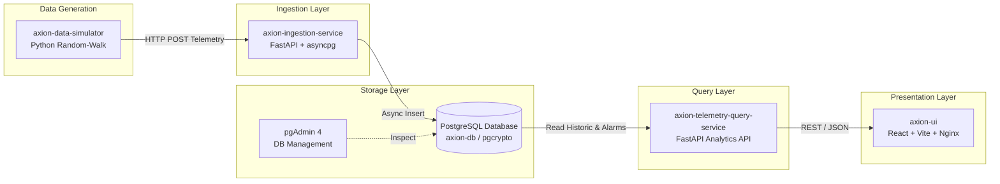

# 🏭 Axion — Industrial IoT Telemetry & Real-Time Monitoring Platform

[](https://www.docker.com/)
[](https://kubernetes.io/)
[](https://fastapi.tiangolo.com/)
[](https://www.postgresql.org/)
[](https://react.dev/)
[](https://vitejs.dev/)
[](https://github.com/features/actions)

---

## 📖 Overview

**Axion** is an end-to-end, enterprise-grade Industrial IoT (IIoT) telemetry platform designed to simulate, ingest, store, query, and visualize high-frequency sensor readings from refinery equipment (compressors, pumps, and motors) across geographically distributed plants.

This project features a fully distributed **Microservices Architecture**, complete with **Docker containerization**, **Kubernetes orchestration manifests**, and **automated GitHub Actions CI/CD workflows**.

> **Note**: This repository brings together the complete Axion microservices ecosystem into a unified monorepo with production-grade Docker packaging and Kubernetes deployment configurations.

---

## 🏗️ Architecture & Data Flow



1. **IoT Simulation**: `axion-data-simulator` continuously emits realistic physical metrics (temperature, vibration, current) for 8 devices across 3 refinery zones with a 1% anomaly spike probability.
2. **High-Speed Ingestion**: `axion-ingestion-service` accepts HTTP POST payloads, validates them with Pydantic, and writes them asynchronously to PostgreSQL using connection pooling (`asyncpg`).
3. **Data Persistence**: `axion-database-schema` maintains indexed tables for high-throughput time-series readings and anomaly alerts with UUID primary keys.
4. **Analytics & Query**: `axion-telemetry-query-service` aggregates metrics, monitors active boundary thresholds, and serves historic trends and operational summaries.
5. **Real-Time UI**: `axion-ui` renders operational dashboards, live sensor trends, asset health lists, and interactive plant map widgets.

---

## 📁 Repository Structure

```
AxionProject/
├── README.md                                # Root project documentation
│
├── axion-data-simulator/                    # IoT Telemetry Generator Microservice
│   ├── Dockerfile                           # Python 3.12-slim container image
│   ├── requirements.txt                     # requests & dependencies
│   ├── simulator.py                         # Telemetry generation engine
│   ├── .github/workflows/docker-build-push.yml # CI/CD for Docker image build & push
│   └── manifests/
│       └── deployment.yaml                  # Kubernetes Deployment manifest
│
├── axion-database-schema/                   # Database DDL & Management Tools
│   ├── 01-extensions.sql                    # pgcrypto extension setup
│   ├── 02-telemetry.sql                     # Telemetry table and B-Tree indexes
│   ├── 03-alerts.sql                        # Alerts schema
│   └── manifests/                           # Kubernetes Infrastructure Manifests
│       ├── postgres-deployment.yaml         # PostgreSQL 17 Deployment & Service
│       ├── pgadmin-deployment.yaml          # pgAdmin4 Web UI Deployment
│       └── firefox-pod.yaml                 # In-cluster browser test Pod
│
├── axion-ingestion-service/                 # Ingestion REST API Microservice
│   ├── Dockerfile                           # Python 3.12-slim container image
│   ├── main.py                              # FastAPI routing and lifespan
│   ├── database.py                          # asyncpg connection pooling
│   ├── models.py                            # Pydantic v2 schemas
│   ├── config.py                            # Configuration dataclass
│   ├── requirements.txt                     # fastapi, uvicorn, asyncpg, pydantic
│   ├── .env.example                         # Sample environment variables
│   └── .github/workflows/docker-build-push.yml
│
├── axion-telemetry-query-service/           # Query & Analytics Microservice
│   ├── Dockerfile                           # Python 3.12-slim container image
│   ├── main.py                              # FastAPI query routes (/dashboard, /regions)
│   ├── database.py                          # Database querying layer
│   ├── config.py                            # App configuration
│   ├── requirements.txt                     # Python dependencies
│   └── .github/workflows/docker-build-push.yml
│
└── axion-ui/                                # Frontend Industrial Dashboard
    ├── Dockerfile                           # Multi-stage build (Node 20 -> Nginx Alpine)
    ├── nginx.conf                           # Nginx SPA reverse proxy & routing config
    ├── package.json                         # React 18, TypeScript, Vite, Tailwind
    ├── vite.config.ts                       # Vite bundler configuration
    ├── src/                                 # Dashboard views, components, live charts
    └── .github/workflows/docker-build-push.yml
```

---

## 🧩 Microservices Breakdown

### 1. 📈 Axion Data Simulator (`axion-data-simulator`)
- **Technology**: Python 3.12, Requests
- **Role**: Simulates industrial field equipment (pumps, compressors, motors).
- **Physical Metrics Simulated**:
  | Metric | Unit | Normal Range | Anomaly Behavior |
  | :--- | :--- | :--- | :--- |
  | **Temperature** | °C | 20°C – 150°C | Spikes upon thermal stress |
  | **Vibration** | mm/s | 0.0 – 15.0 mm/s | Exceeds safe bounds during mechanical imbalance |
  | **Current** | A | 0.0 – 100.0 A | Escalates during electrical surges |
- **Configuration**:
  - `API_URL`: Target Ingestion Service endpoint (e.g. `http://axion-ingestion-service:8000/api/v1/telemetry/ingest`)
  - `INTERVAL_SECONDS`: Emission interval (default `5`s)

### 2. 🛢️ Database Schema (`axion-database-schema`)
- **Technology**: PostgreSQL 17.x with `pgcrypto`
- **Tables**:
  - `telemetry`: High-frequency sensor values (`id UUID`, `device_id`, `device_type`, `refinery_region`, `timestamp`, `temperature`, `vibration`, `current`, `created_at`).
  - `alerts`: Anomaly alerts with acknowledgment tracking (`acknowledged BOOLEAN`, `severity`, `message`).
- **Indexes**:
  - `idx_telemetry_device_id` on `device_id`
  - `idx_telemetry_timestamp` on `timestamp DESC`
  - `idx_alerts_acknowledged` on `acknowledged`

### 3. ⚡ Axion Ingestion Service (`axion-ingestion-service`)
- **Technology**: FastAPI 0.115, Uvicorn, asyncpg, Pydantic v2
- **Key Endpoints**:
  - `POST /api/v1/telemetry/ingest`: Ingests and persists single telemetry reading
  - `GET /api/v1/telemetry?deviceId=...&limit=...`: Retrieves recent records
  - `GET /health`: Liveness / readiness health probe
- **Configuration**:
  - `DATABASE_URL`: `postgresql://<db_user>:<db_password>@<db_host>:<db_port>/<db_name>`

### 4. 🔍 Axion Telemetry Query Service (`axion-telemetry-query-service`)
- **Technology**: FastAPI, Uvicorn, PostgreSQL
- **Key Endpoints**:
  - `GET /`: Health check / status confirmation
  - `GET /dashboard/summary`: Aggregated operational metrics, active alerts, and status
  - `GET /regions`: Region-wise status and device distribution
  - `GET /docs`: Interactive OpenAPI / Swagger UI documentation

### 5. 💻 Axion UI (`axion-ui`)
- **Technology**: React 18, TypeScript, Vite, Tailwind CSS, Lucide React
- **Features**:
  - Asset Health List with dynamic status indicators (Healthy, Warning, Critical)
  - Live Trend charts for real-time vibration, temperature, and current
  - Geographic Refinery Plant Map widget
  - System throughput and anomaly detection feeds
- **Deployment**: Multi-stage Docker container served via high-performance **Nginx Alpine**.

---

## 🐳 Docker Containerization

Every microservice in Axion contains a dedicated `Dockerfile` optimized for minimal footprint, layer caching, and production security.

### Build and Run with Docker

#### 1. Ingestion Service
```bash
cd axion-ingestion-service
docker build -t axion-ingestion-service:latest .
docker run -d -p 8000:8000 \
  -e DATABASE_URL="postgresql://<DB_USER>:<DB_PASSWORD>@host.docker.internal:5432/<DB_NAME>" \
  --name axion-ingestion \
  axion-ingestion-service:latest
```

#### 2. Telemetry Query Service
```bash
cd axion-telemetry-query-service
docker build -t axion-telemetry-query-service:latest .
docker run -d -p 8001:8000 \
  -e DATABASE_URL="postgresql://<DB_USER>:<DB_PASSWORD>@host.docker.internal:5432/<DB_NAME>" \
  --name axion-query \
  axion-telemetry-query-service:latest
```

#### 3. Data Simulator
```bash
cd axion-data-simulator
docker build -t axion-data-simulator:latest .
docker run -d \
  -e API_URL="http://host.docker.internal:8000/api/v1/telemetry/ingest" \
  -e INTERVAL_SECONDS="3" \
  --name axion-simulator \
  axion-data-simulator:latest
```

#### 4. Frontend UI
```bash
cd axion-ui
docker build -t axion-ui:latest .
docker run -d -p 80:80 --name axion-ui axion-ui:latest
```

---

## ☸️ Kubernetes (K8s) Deployment

Production-ready Kubernetes manifests are organized under `manifests/` directories to deploy the database and support services to any Kubernetes cluster.

### Deploying Infrastructure & Database

```bash
# 1. Deploy PostgreSQL
kubectl apply -f axion-database-schema/manifests/postgres-deployment.yaml

# 2. Deploy pgAdmin4 (Database Management Web UI)
kubectl apply -f axion-database-schema/manifests/pgadmin-deployment.yaml

# 3. (Optional) Deploy In-Cluster Test Pod
kubectl apply -f axion-database-schema/manifests/firefox-pod.yaml

# 4. Deploy Data Simulator Client
kubectl apply -f axion-data-simulator/manifests/deployment.yaml
```

### Check Cluster Status
```bash
kubectl get pods -o wide
kubectl get deployments
kubectl get services
```

### Port-Forwarding for Local Testing
```bash
# Access PostgreSQL
kubectl port-forward deployment/postgres-deployment 5432:5432

# Access pgAdmin
kubectl port-forward deployment/pgadmin-deployment 8080:80
```
> Open `http://localhost:8080` in your browser and sign in using the administrator credentials configured in your environment or Kubernetes secrets.

---

## 🔄 CI/CD Automation

Each microservice includes a GitHub Actions workflow (`.github/workflows/docker-build-push.yml`) configured for automated container builds:

- **Trigger**: Pushes to `main` branch or manual `workflow_dispatch`.
- **Pipeline Actions**:
  1. Clones repository code with `actions/checkout@v4`.
  2. Configures Docker Buildx with `docker/setup-buildx-action@v3`.
  3. Authenticates with Docker Hub using repository secrets (`DOCKERHUB_USERNAME`, `DOCKERHUB_TOKEN`).
  4. Generates dynamic tags (`latest` and commit SHA).
  5. Builds and pushes the image with GitHub Actions layer caching enabled (`type=gha`).

---

## ⚙️ Environment Variables Reference

> 🔒 **Security Notice**: Never commit sensitive database credentials or access tokens into version control. Use `.env` files (ignored in `.gitignore`) or Kubernetes `Secret` resources in production.

| Microservice | Variable | Example / Placeholder | Description |
| :--- | :--- | :--- | :--- |
| **`axion-data-simulator`** | `API_URL` | `http://axion-ingestion-service:8000/api/v1/telemetry/ingest` | Telemetry target endpoint |
| | `INTERVAL_SECONDS` | `5` | Emission interval in seconds |
| **`axion-ingestion-service`** | `DATABASE_URL` | `postgresql://<user>:<password>@<host>:<port>/<dbname>` | PostgreSQL connection URL |
| | `PORT` | `8000` | HTTP service port |
| **`axion-telemetry-query-service`** | `DATABASE_URL` | `postgresql://<user>:<password>@<host>:<port>/<dbname>` | Database connection URL |
| | `PORT` | `8000` | Query service port |
| **`axion-database-schema`** | `POSTGRES_USER` | `<your-db-user>` | Superuser name |
| | `POSTGRES_PASSWORD` | `<your-db-password>` | Secure database password |
| | `POSTGRES_DB` | `<your-db-name>` | Primary database name |

---

## 🚀 How to Push this Entire Monorepo to Your GitHub

If you have submodules or inner `.git` folders from cloning separate services, follow these steps to push all files and services together cleanly as a **single complete project**:

### Step 1: Remove Inner `.git` Folders
Run PowerShell in the project root:
```powershell
# Remove nested .git folders so Git tracks all files directly
Remove-Item -Recurse -Force axion-data-simulator\.git -ErrorAction SilentlyContinue
Remove-Item -Recurse -Force axion-database-schema\.git -ErrorAction SilentlyContinue
Remove-Item -Recurse -Force axion-ingestion-service\.git -ErrorAction SilentlyContinue
Remove-Item -Recurse -Force axion-telemetry-query-service\.git -ErrorAction SilentlyContinue
Remove-Item -Recurse -Force axion-ui\.git -ErrorAction SilentlyContinue
```

### Step 2: Clear Submodule Cache from Main Git
```powershell
# Remove any git submodule link cache
git rm --cached axion-ingestion-service axion-telemetry-query-service axion-ui -r -f -ErrorAction SilentlyContinue
```

### Step 3: Stage All Project Files
```powershell
git add .
git status
```

### Step 4: Commit Your Work
```powershell
git commit -m "feat: complete Axion IoT platform with Docker, Kubernetes manifests, and comprehensive README"
```

### Step 5: Set Your GitHub Remote & Push
```powershell
# If your repo remote is already configured:
git push -u origin main

# OR if pushing to a new repository on your GitHub account:
# git remote set-url origin https://github.com/<YOUR-USERNAME>/<YOUR-REPO-NAME>.git
# git branch -M main
# git push -u origin main
```

---

## 👩‍💻 Contributors & Attribution

- **Original Base Architecture**: [DevOps Insiders](https://github.com/devopsinsiders)
- **Containerization & Kubernetes Engineering**:
  - Implemented Dockerfiles across all microservices
  - Configured multi-stage build pipelines for React & Nginx
  - Authored Kubernetes Deployments, Services, and Pod manifests
  - Created centralized project documentation and Git monorepo structure

---

## 📄 License

This project is licensed under the [MIT License](LICENSE).
